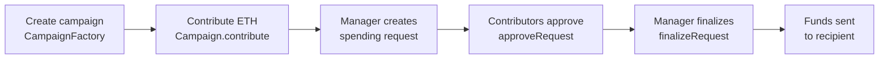

<div align="center">
  

  <p><code>Two Ethereum dApps from my Solidity course on Udemy: a lottery and a crowdfunding platform with voting.</code></p>

  <p>
    <a href="https://github.com/Saji-d/blockchain-ethereum-solidity-learning-journey"></a>
    
    
  </p>
  <p>
    
    
    
    
    
    
    
    
  </p>

  <p>
    <a href="#-overview">Overview</a> ·
    <a href="#-highlights">Highlights</a> ·
    <a href="#-the-projects">The Projects</a> ·
    <a href="#-what-is-inside">What is Inside</a> ·
    <a href="#-tech-stack">Tech Stack</a> ·
    <a href="#-how-to-run">How to Run</a> ·
    <a href="#-author">Author</a>
  </p>
</div>


## ◈ Overview

This repository documents my learning journey in Ethereum development and Solidity smart contract programming, following the Ethereum and Solidity course on Udemy.

It is a **learning repository, not a product**. Both projects are built and tested on a local Hardhat blockchain with MetaMask as the wallet. Nothing here is audited or intended to hold real funds.


## ◈ Highlights

<table>
  <tr>
    <td width="33%" valign="top"><b>Payable contracts</b><br>Players enter the lottery by sending Ether and the winner receives the pool.</td>
    <td width="33%" valign="top"><b>Access control</b><br>A <code>restricted</code> modifier limits winner selection and fund release to the manager.</td>
    <td width="33%" valign="top"><b>Factory pattern</b><br>A <code>CampaignFactory</code> deploys one <code>Campaign</code> contract per fundraiser.</td>
  </tr>
  <tr>
    <td valign="top"><b>Voting on spending</b><br>Contributors approve a request before the manager can finalize it.</td>
    <td valign="top"><b>Reentrancy protection</b><br>Contribute and finalize use <code>nonReentrant</code> from a <code>ReentrancyGuard</code>.</td>
    <td valign="top"><b>Wallet-connected front ends</b><br>A Vite and React app with Ethers.js and a Next.js app with Wagmi and Viem.</td>
  </tr>
  <tr>
    <td valign="top"><b>Contract tests</b><br>Hardhat test suites for both contracts.</td>
    <td valign="top"><b>Scripted deployment</b><br>A deploy script for the lottery and an Ignition module for the factory.</td>
    <td valign="top"><b>Typed bindings</b><br>Generated Ethers contract types in the lottery project.</td>
  </tr>
</table>


## ◈ The Projects

### Lottery Contract dApp

Participants enter by sending ETH to the `Lottery` contract. The manager picks a winner, who receives the whole prize pool. The React front end connects MetaMask, shows the balance and the participant count and exposes a manager-only winner button.

Contract functions: `enter()`, `pickWinner()` (restricted) and `getPlayers()`.

### Crowdfund dApp

A crowdfunding platform where anyone can start a campaign and contributors fund it with ETH. The manager raises spending requests, contributors approve them and the manager finalizes approved requests to release funds to the recipient.



Contract functions: `createCampaign()` and `getDeployedCampaigns()` on the factory, then `contribute()`, `createRequest()`, `approveRequest()`, `finalizeRequest()`, `getRequest()` and `getSummary()` on each campaign.


## ◈ What is Inside

Two independent Hardhat projects, each with its own contracts, tests and front end.

<details>
<summary>Open the folder map</summary>

```text
blockchain-ethereum-solidity-learning-journey/
├── Lottery-Contract/
│   ├── contracts/Lottery.sol
│   ├── test/Lottery.ts
│   ├── scripts/deploy.ts
│   ├── types/ethers-contracts/      generated contract types
│   └── frontend/                    Vite + React + TypeScript + Ethers.js
└── Crowdfund-dApp/
    ├── contracts/                   Campaign.sol, CampaignFactory.sol
    ├── test/                        Campaign.test.ts, simple.test.ts
    ├── ignition/modules/CampaignFactory.ts
    ├── DEPLOYMENT_GUIDE.md
    └── frontend/                    Next.js + Wagmi + Viem + Tailwind CSS
        └── src/app/                 campaigns, new campaign, requests and dashboard pages
```

</details>


## ◈ Tech Stack

| Layer | Technologies | Purpose |
|-------|--------------|---------|
| Contracts | Solidity | Lottery, campaign and factory logic |
| Tooling | Hardhat 3, Hardhat Ignition | Compile, test, local node and deployment |
| Lottery front end | React, TypeScript, Vite, Ethers.js | Wallet connection and contract calls |
| Crowdfund front end | Next.js, TypeScript, Wagmi, Viem, Tailwind CSS | Campaign pages and request workflow |
| Wallet | MetaMask | Signing transactions |


## ◈ How to Run

Requires Node.js, npm and the MetaMask browser extension.

```bash
# Crowdfund dApp
cd Crowdfund-dApp
npm install
npx hardhat test
npx hardhat node                                   # keep running in a separate terminal
npx hardhat ignition deploy ./ignition/modules/CampaignFactory.ts --network localhost
cd frontend && npm install && npm run dev          # http://localhost:3000

# Lottery dApp
cd Lottery-Contract
npm install
npx hardhat test
cd frontend && npm install && npm run dev
```

The Crowdfund project ships a `.env.example` listing `SEPOLIA_RPC_URL`, `PRIVATE_KEY` and `ETHERSCAN_API_KEY` for optional testnet deployment. Keep real values out of version control. See `Crowdfund-dApp/DEPLOYMENT_GUIDE.md` for the full steps.


## ◈ Author

**Sajidur Rahman Sajid**: Full-Stack Developer and AI engineer from Dhaka.<br>
BSc in CSE at American International University-Bangladesh (AIUB).

<p>
  <a href="https://www.sajidur.me"></a>
  <a href="https://www.linkedin.com/in/sajidur-rahman-sajid/"></a>
  <a href="https://github.com/Saji-d"></a>
  <a href="mailto:sajidsajidurrahman99@gmail.com"></a>
</p>

<sub>Learning notes from the Ethereum and Solidity course on Udemy.</sub>
